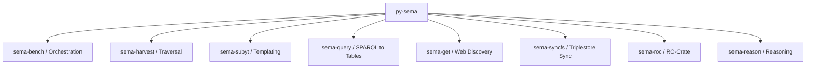

# py-sema

**`py-sema`** is a unified Python package and suite of command-line tools for semantic data processing, knowledge graph operations, and linked data workflows. Developed by the **Open Science Team at VLIZ** (Flanders Marine Institute), it streamlines semantic data engineering by combining harvesting, templating, SPARQL querying, web discovery, triple store synchronization, and pipeline orchestration under one coherent ecosystem.

## Core Capabilities

<CardGroup cols={2}>
  <Card title="Orchestration & Automation" icon="diagram-project" href="/cli/bench">
    Automate multi-step data pipelines with `sema-bench` using declarative YAML files, file watchers, and interval scheduling.
  </Card>
  <Card title="Path Traversal & Harvesting" icon="network-wired" href="/cli/harvest">
    Follow property paths and dereference RDF trajectories across the semantic web with `sema-harvest`.
  </Card>
  <Card title="Jinja2 RDF Templating" icon="code" href="/cli/subyt">
    Convert structured sources (CSV, JSON, XML) into RDF triples using `sema-subyt` with URI templating and row filters.
  </Card>
  <Card title="SPARQL Extraction" icon="table" href="/cli/query">
    Query knowledge graphs, RDF files, or remote endpoints and output tabular data (CSV/TSV) using `sema-query`.
  </Card>
  <Card title="Linked Data Web Discovery" icon="globe" href="/cli/discovery">
    Resolve URIs, negotiate content types, and follow `rel="alternate"` links with provenance tracking using `sema-get`.
  </Card>
  <Card title="Filesystem Triplestore Sync" icon="folder-sync" href="/cli/syncfs">
    Synchronize folder hierarchies of RDF files with SPARQL endpoints and named graphs using `sema-syncfs`.
  </Card>
</CardGroup>

## Consolidated Architecture

`py-sema` unites several previously standalone tools into a single modular architecture:

| Modern Tool | Legacy Predecessor | Core Responsibility |
| :--- | :--- | :--- |
| `sema-bench` | `sembench` | Pipeline execution, scheduling, and task management |
| `sema-harvest` | `travharv` | Traversal, path assertions, and graph harvesting |
| `sema-subyt` | `pysubyt` | Templating tabular/structured data into RDF |
| `sema-query` | `kg2tbl` | Extracting tables from knowledge graphs with SPARQL |
| `sema-get` | `webdiscovery` | URI dereferencing, content negotiation, and link discovery |
| `sema-syncfs` | `syncfstriples` | Synchronizing local RDF files with triplestores |
| `sema-roc` / `sema-ro-get` | - | RO-Crate metadata generation and package retrieval |
| `sema-reason` | - | SPARQL CONSTRUCT rule reasoning and inference |

## Next Steps

<CardGroup cols={2}>
  <Card title="Quickstart Guide" icon="rocket" href="/quickstart">
    Install `py-sema` and run your first semantic pipeline in minutes.
  </Card>
  <Card title="Core CLI Tools" icon="terminal" href="/cli/bench">
    Explore the full command-line reference and options for every CLI tool.
  </Card>
</CardGroup>
