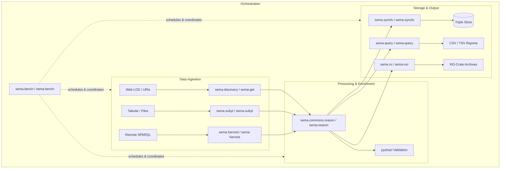

`py-sema` serves as the unified umbrella for semantic RDF tools originally created by the Open Science Team at VLIZ. This page details the system design, consolidation roadmap, and migration from legacy tools.

## Architectural Overview

`py-sema` decomposes semantic data engineering into modular, interoperable layers:



## Migration from Legacy Packages

If you are migrating existing scripts or Docker containers from the standalone VLIZ semantic packages, use this reference:

### Package Imports

```python
# Legacy imports
from travharv import TravHarv
from pysubyt import Subyt
from kg2tbl import kg2tbl
from sembench import Sembench
from syncfstriples import SyncFsTriples
from webdiscovery import WebDiscovery

# Modern py-sema imports
from sema.harvest import Harvest
from sema.subyt import Subyt
from sema.query import DefaultSparqlBuilder, GraphSource
from sema.bench import Sembench
from sema.syncfs import SyncFsTriples
from sema.discovery import Discovery
```

### Command Line Binaries

| Legacy Command | Modern `py-sema` Command | Key Changes |
| :--- | :--- | :--- |
| `travharv` | `sema-harvest` | Unified `-c`, `-s`, `-d`, `-i` flags |
| `pysubyt` | `sema-subyt` | Enhanced multi-source `--set` support |
| `kg2tbl` | `sema-query` | Template bundling via `sema-query-templates` |
| `sembench` | `sema-bench` | Native handlers for SHACL, Reasoner, and RO-Crate |
| `syncfstriples` | `sema-syncfs` | Improved admin graph diffing |
| `webdiscovery` | `sema-get` | Extended MIME normalization and link parsing |

## Design Principles

1. **Service Standard**: Every core capability is exposed as an autonomous service class adhering to `.process()` execution semantics.
2. **Standardized CLI Experience**: Consistent flag naming (`-o/--output`, `-i/--input`, `-l/--logconf`) across all command-line executables via `SemaArgsParser`.
3. **Format Agnosticism**: Deep integration with RDFLib enables reading, processing, and serializing Turtle, JSON-LD, N-Triples, RDF/XML, and TriG effortlessly.
4. **Reproducibility**: Strong provenance tracking via W3C PROV-O structures across web discoveries, harvests, and filesystem synchronizations.

